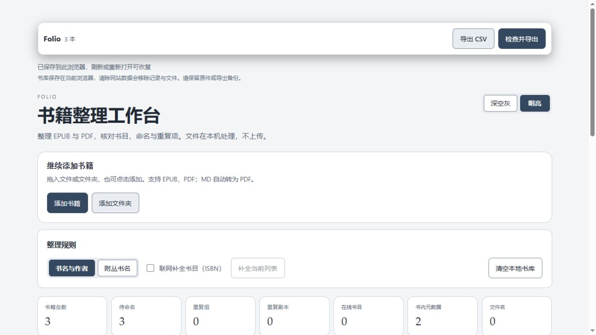

# Folio Library

在浏览器中整理 EPUB / PDF 的轻量工具：识别书目、校正命名、比较重复项、补封面，并导出书籍与 Markdown 阅读笔记。

**本地优先 · 书籍文件零上传 · 私有书库**

[在线使用](https://questfrontiers.com/folio-library/) · [一分钟演示](https://questfrontiers.com/folio-library/demo/) · [部署说明](docs/deployment.md) · [发布记录](https://github.com/XmyHee/folio-library/actions/workflows/pages.yml)

[](https://app.netlify.com/start/deploy?repository=https://github.com/XmyHee/folio-library)

文件解析、MD 转 PDF、封面和导出均在当前浏览器完成，书籍文件不上传到 Folio 或第三方转换服务器。无需账户、无需文件处理后端；书库保存在本机浏览器。可选 ISBN 补全会发送 ISBN，详见下方隐私说明。

## 一分钟看懂 Folio

<a href="https://questfrontiers.com/folio-library/demo/"></a>

[播放 60 秒演示](https://questfrontiers.com/folio-library/demo/) · [下载 MP4](public/demo/folio-demo.mp4)

演示使用合成 EPUB / PDF / MD，展示自动转换、分批追加、人工审核与实际导出。中文内嵌字幕、无声，由实测画面剪辑；视频时长不代表实际处理速度。

<details>
<summary>明亮主题截图</summary>



</details>

## 为什么选择本地处理

| 维度 | Folio | 云端转换工具（以 CloudConvert 为例） |
| --- | --- | --- |
| 文件与隐私 | 书籍文件留在当前浏览器；ISBN 查询可关闭 | 文件传输至云端处理，按服务方政策删除 |
| 批量处理 | 文件夹导入、分批追加、跨筛选勾选、命名去重与结果追踪；受本机资源限制 | 使用云端资源，容量与处理限制由服务方规定 |
| 离线 | 本地静态服务 / Docker 部署完成，关闭 ISBN 联网后可在无互联网环境处理 | 云端转换依赖网络 |
| 适用任务 | EPUB / PDF 书库整理，MD 自动转 PDF 与阅读笔记导出 | 更广泛的文件格式转换 |

对比的是处理方式，不表示所有网页工具都会上传文件。CloudConvert 的云端处理、传输和删除规则见其[官方安全说明](https://cloudconvert.com/security)（核对于 2026-10-13）。Folio 的“大批量”指分批整理书库，不是无限大小：列表每页 40 本，单次 ZIP 内容上限 256 MiB。在线站点未提供离线安装包或 Service Worker；不要依赖浏览器缓存承诺断网冷启动。

## 快速部署

- **静态托管**：点击上方 Netlify 按钮，按平台提示创建站点。仓库已配置根路径构建；GitHub Pages 默认保留 `/folio-library/`。第三方账户授权与费用由您在平台确认。
- **Docker**：下载仓库或克隆后，在项目目录执行 `docker compose up --build -d`，打开 [localhost:8080](http://localhost:8080/)。首次构建需联网拉取镜像与依赖；之后的本地文件处理可离线运行。

Docker 只提供静态页面，不接收或存储书籍文件。书库仍在浏览器的 IndexedDB 中；不同域名、端口或浏览器的书库不共享。详细操作、基础路径和验证方式见[部署说明](docs/deployment.md)。

## 使用流程

1. 点击“添加书籍”或“添加文件夹”，也可把文件拖入页面任意位置。分批添加会保留已有书籍。MD / Markdown 文件经同一入口添加后自动转为 PDF，再按普通 PDF 整理；本地图片请随文件夹一起导入。
2. 用“全部书籍 / 待命名 / 去重”查看结果，再按书名、作者、审核状态或封面条件筛选。
3. 打开书籍详情，修改书名和作者，保存后确认审核。桌面端使用侧栏，“上一本 / 下一本”可连续处理；手机端使用整页详情。未应用的修改可以保存、保留为标签页草稿或放弃。
4. 按需为无封面书籍、论文和文献生成封面。请先核对候选范围：PDF 首页也可能已是封面，不会仅凭这一条件自动批量改动。
5. 点击“检查并导出书库与笔记”，核对范围、待审核项、输出路径和模板，再下载 ZIP。

## 书目与审核

- 通过文件内容识别 EPUB / PDF，检查扩展名与实际格式是否一致。
- 综合内置元数据、前页可选文字和文件名，提取标题、作者、ISBN、语言、出版社、日期与丛书。论文识别支持摘要、arXiv 等线索与多作者排版。
- 中文文件名与外语书目冲突时保留中文命名，并列出差异。中文命名中的外国作者使用有依据的国籍，不凭姓名猜测；英文书籍不套用此规则。
- 人工校正优先于自动识别。信息异常与人工审核分别显示：确认审核不代表缺失信息已经补齐；书目变化后需要重新审核。
- 去重顺序为完整 SHA-256、ISBN、归一化书名作者、严格模糊匹配。不同卷册与不同 ISBN 有保护规则；候选组应人工比较，允许切换保留版本。
- “书名与作者 / 附丛书名”控制建议文件名。工具不直接重命名或覆盖磁盘上的源文件，改动体现在导出包中。

## 批量范围与封面

每行可勾选。选择当前结果与选择全库是两个独立按钮；“当前结果”包括筛选结果的所有页，不仅是当前页。勾选跨页、跨筛选保留，刷新后重置。

CSV 和批量封面可选择“当前结果 / 勾选书籍”。ZIP 的范围在导出检查中单独确认，可选择全部、当前结果、勾选项或上次失败项，并可排除待审核书籍。

PDF 显示实际第一页；EPUB 显示原封面或可读取的前页。生成封面只使用已有或手动填写的标题与作者，不添加占位文字。PDF 封面适配原页尺寸并置于正文前；EPUB 写入封面资源与阅读顺序。导出时才嵌入，原件另行保留。可以切回原文预览或重新识别，未生成的封面不影响原件。

## 导出包

顶层固定为以下四项，不导出 JSON 或模板副本：

```text
folio-library.zip
├── README.md
├── folio-export-result.csv
├── Library/
│   ├── 完整书名 - 作者.pdf 或 .epub
│   └── Notes/完整书名 - 作者.md
└── Originals/
    ├── 原始 MD 与引用图片 / 新增封面前的原件（按书籍分目录）
    └── Duplicates/保留的重复副本（启用时）
```

文件夹即使为空也保留。结果 CSV 记录完整书名、作者、书籍 ID、实际路径、审核状态、校验值，以及成功、失败、排除原因。单本失败不伪装为成功，其余成功项可生成 `folio-library-partial.zip`；页面可查看结果并重试失败项。

Markdown 模板支持：`{{TITLE}}`、`{{AUTHOR}}`、`{{AUTHORS}}`、`{{PUBLISHER}}`、`{{ISBN}}`、`{{LANGUAGE}}`、`{{DATE}}`、`{{SERIES}}`、`{{SUBJECTS}}`、`{{BOOK_ID}}`、`{{SOURCE_PATH}}`、`{{FILE_LINK}}`、`{{REVIEW_STATUS}}`。默认不附加末尾链接或 ID，需要时自行加入模板。模板只填写书目，不自动编造阅读分析。导出新包不会合并或覆盖已经在本地编辑的笔记。

## 本地保存与隐私

- 文件解析、命名、封面和导出均在浏览器运行，无需上传书籍文件，无需 Python 后端。
- ISBN 联网补全向 Google Books / Open Library 发送 ISBN 查询，服务方会收到正常网络请求信息；不发送书籍正文或文件。可在导入前关闭，失败或超时可重试，已完成的结果保留。
- 书库使用 IndexedDB 保存。书目与文件分开存储，修改书目时不重写未改变的文件。旧版快照首次成功保存时原子迁移，保留 ID 和人工校正；旧版清空副本会删除。
- 清空需确认。删除成功后移除本地书籍、封面、书目与导出记录，不保留撤销副本，刷新不会恢复。清空前的保存操作按顺序完成；删除失败会保留当前列表并报错。磁盘原文件与已下载的导出包不受影响，阅读模板和整理偏好保留。
- 保存失败会明确提示。多个页面发生更新冲突时拒绝旧页面覆盖，请先导出当前修改，再刷新。不要用多个标签页同时编辑同一书库。
- 浏览器、用户配置、协议或域名不同，书库不共享；HTTP 与 HTTPS 也属于不同来源。清理网站数据、无痕模式结束或浏览器回收存储可能导致数据丢失。请保留原件和定期导出备份。

## 性能与限制

列表每页最多 40 本，去重每页最多 40 个完整组；分页不改变批量范围。导入 / 联网补全 / ZIP 导出可停止，批量封面也有取消入口。MD 转换通过独立工作线程执行，取消时终止当前转换；其他解析与封面在当前文件完成后停止；已完成的导入和封面保留，取消 ZIP 不触发下载。

扫描 PDF 暂无 OCR；加密、损坏、非常规排版或缺失文本可能需要人工校正。自动识别和相似去重不能保证所有书籍均准确。单个 EPUB / PDF 超过 256 MiB 时不进行整本解析；批次包含至少 32 MiB 的书籍时逐本解析。ZIP 仍在内存中构建，预计单次打包内容上限 256 MiB，包含保留的原件、Markdown 图片与生成封面；超限时提示用勾选范围分批导出。这个上限用于降低风险，不保证所有设备或复杂文件都不会内存不足；分页不降低文件本身的存储与导出内存需求。普通导出复用已读取的文件字节，避免同一文件重复占用整块内存。页面渲染异常会显示重新加载入口，不清空已保存书库；浏览器或系统直接终止进程仍无法由网页兜底。

开发检查包含 600 本合成 PDF（约 38 MiB）的保存、恢复及单本校正，以及 85 本合成书籍的浏览器分页、草稿、勾选和实际导出验证。这不代表任意大小真实书库的性能保证。

## 本地开发

使用 Node.js 22 与 npm。通过本地 HTTP 服务打开，不直接双击 HTML：

```sh
npm ci
npm run dev
```

打开终端提示的 `/folio-library/` 地址。生产构建及预览：

```sh
npm run check
npm run preview
```

`npm run check` 依次运行 TypeScript 检查、回归测试、生产构建。也可分别运行 `npm run typecheck`、`npm test`、`npm run build`。测试使用合成文件和最小书目前页文字样例，不需要私人书库。浏览器交互与部署后的访问另行验证，单元测试不替代这两项检查。

共享书库、任务、筛选选择、详情编辑和导出状态由同一个 Zustand store 管理，每个工作台实例独立。IndexedDB 仍由原有保存流程负责，不新增文件副本或存储格式迁移。状态集中本身不是稳定性保证：`check-store.cjs` 逐项回归分批导入、取消期间锁定、恢复失败禁止写入、清空失败保留书库，以及最新导出范围和订阅隔离。

主要代码：

```text
src/App.tsx                 页面组合与功能命令连接
src/state/                  统一 Zustand store、Provider 与派生选择器
src/containers/             导入、规则、书库、导出与详情容器
src/commands/               导入、书目补全、清空、审核、封面与导出命令
src/components/             导入、列表、详情和导出界面
src/hooks/useLibraryState.ts 保存恢复、模板保存与清空生命周期
src/hooks/useBookDetails.ts  详情选择、草稿和未保存修改提示
src/hooks/useTaskState.ts    共用任务锁、取消状态和进度
src/hooks/useLibraryView.ts  搜索、筛选、勾选与分页
src/hooks/useFileIntake.ts   文件选择入口与全页拖放
src/lib/parse.ts            文件识别和解析
src/lib/resolve.ts          书目来源与冲突处理
src/lib/pipeline.ts         命名与去重
src/lib/storage.ts          增量保存、迁移和冲突保护
src/lib/document-cover.ts   生成封面
src/lib/embed-cover.ts      PDF / EPUB 嵌入
src/lib/export-plan.ts      导出前检查、范围和路径
src/lib/export.ts           CSV、ZIP 和结果记录
src/lib/notes.ts            Markdown 模板渲染
check-*.cjs / test.cjs       回归与存储验证
.github/workflows/pages.yml 检查、构建和 GitHub Pages 部署
```

模块职责、数据归属和扩展规则见 [架构说明](docs/architecture.md)，现有功能的维护顺序见 [维护计划](docs/maintenance-plan.md)。React 生命周期与功能命令分别通过公开接口测试，原先依赖 App 函数位置的四项测试已迁移。测试依赖只用于开发，不进入线上应用。MD 在浏览器中自动转为 PDF，支持中文嵌入字体、标题、列表、引用、代码、表格、链接、本地图片、YAML 元数据和页眉页脚。导入后自动转换，不提供排版或重新转换入口；可通过文档内 YAML 指定排版。详情按文件信息、校正书目、封面设置排列，默认展开；更多书目与识别信息默认折叠。支持范围和限制见 [Markdown 转 PDF](docs/markdown-to-pdf.md)，重构过程见 [实施计划](docs/markdown-import-plan.md)。首次转换需从本站加载约 13 MB 字体，随后由浏览器缓存；不上传文档。

## 线上部署

当前项目入口为 `https://questfrontiers.com/folio-library/`，Vite 的 `base` 为 `/folio-library/`。部署到其他子目录时必须同步修改 `vite.config.ts`。使用 HTTPS，确保 Web Crypto 等浏览器功能可用。

GitHub 仓库为 `XmyHee/folio-library`。仓库 Pages 使用 GitHub Actions；推送 `main` 或手动运行 `pages.yml` 后，依次安装锁定依赖、检查类型、执行测试、构建 `dist` 并部署。检查失败不会进入部署步骤。

发布前检查待提交文件，勿提交书籍原件、私人模板、下载包或本地测试页面。发布后核对 Actions 成功、实际网站及新资源加载，而不是只确认推送成功。静态站点升级不主动清空浏览器书库；再次打开后等待页面显示保存完成。

若需要回退代码，回退对应提交并重新执行发布。数据库 v2 迁移后，旧版只支持 v1 的应用不能直接读取新结构，因此不要把代码回退当作数据回退：先导出备份，再使用兼容数据库 v2 的版本恢复。

### 任务进度

顶部固定栏统一显示导入读取、MD 自动转 PDF、联网补全、批量封面及导出的当前状态。导入与导出准备按已处理文件计数，ZIP 生成显示本阶段百分比；单个大文件的处理时间无法预估时仍显示活动条及等待提示。任务结束、失败或停止完成后进度提示收起。减少动态效果的系统设置会关闭跑动动画。

容器拆分保持增量：导入反馈、整理规则、书库浏览、导出与详情已移入独立容器。共享状态已迁入 Zustand，保留原有保存队列和任务锁语义；列表仍使用分页，尚未新增虚拟化。

顶部固定操作栏集中放置导出 CSV、检查并导出及任务进度；添加书籍/文件夹保留在主页中间的说明区域。检查入口会定位到导出前检查；整理规则不再重复放置导出按钮。窄屏两个导出按钮并排，清空书库留在整理规则区域。

空书库首页保留大框导入区，添加书籍后切换为紧凑追加区。首页统计使用“待命名”“重复副本”“在线书目”，分别表示建议命名变化、识别出的副本和采用的在线书目；不会直接改动磁盘原文件。导出检查中的笔记模板默认折叠，按需展开。
